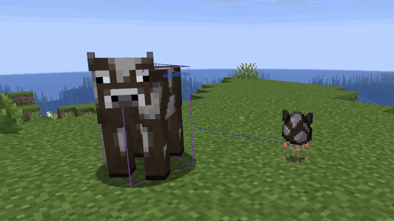
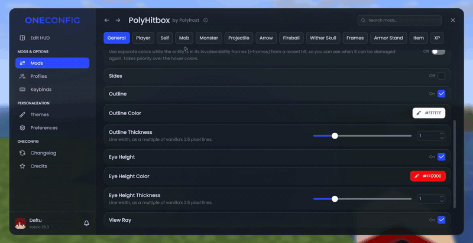
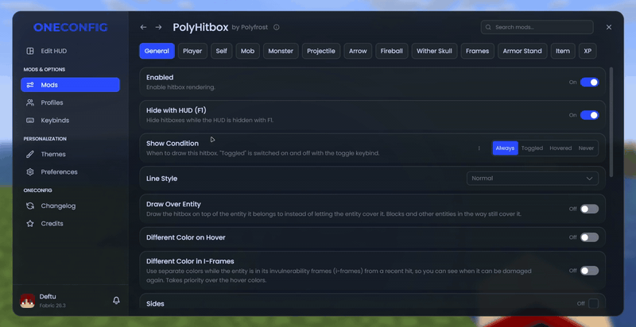

# PolyHitbox

PolyHitbox replaces Minecraft's hitboxes with ones you can style, down to which entities get one.

### What you can change

- Toggle the outline, filled sides, eye height ring and view ray separately
- Custom color and line thickness for each of them
- Solid or dashed lines
- A different color for the entity you are looking at
- A different color while an entity is in i-frames, so you can see when it can be hit again
- Draw hitboxes on top of their entity

### When they show

- Always, only for the entity under your crosshair, or toggled with a keybind
- Hidden together with the HUD when you press F1
- Hide the hitboxes of arrows stuck in blocks

### Per entity type

All of the above can be set differently for players, yourself, mobs, monsters, projectiles, arrows, fireballs, wither skulls, item frames, armor stands, items and XP orbs.

On 1.8.9, "Accurate Hitboxes" draws each hitbox at the size attacks register against.

## Compatibility

PolyHitbox doesn't work together with Combat Hitboxes.

## Supported versions

- Minecraft 1.8.9 on Ornithe.
- Minecraft 1.21.1-26.3 on Fabric.

PolyHitbox needs [OneConfig](https://modrinth.com/mod/oneconfig) and Fabric Language Kotlin.

## Support

- Report bugs and ask questions on the [Polyfrost Discord](https://polyfrost.org/discord).
- Check [Polyfrost Status](https://status.polyfrost.org/) if a Polyfrost service is down.
